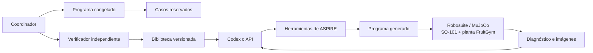

# ASPIRE: SO-101 y benchmark de cosecha de fresas

La adaptación conserva el flujo de ASPIRE: explorar, generar un programa sin
política inicial, ejecutarlo en desarrollo, diagnosticar fallos y corregirlo.
El coordinador congela la selección, revisa su procedencia, mide casos nuevos y
ejecuta la evaluación final. Las habilidades solo se incorporan tras una
reproducción independiente.

El criterio de integración es que funcionen estos sistemas y evalúen con
honestidad. No exige que el robot complete la cosecha: `done` describe el
protocolo terminado; `task_success` describe el resultado físico.

El controlador puede ser Codex con su sesión guardada o una API compatible con
Responses. Ambos utilizan las mismas seis herramientas, APIs del robot,
observaciones, límites y evaluación. El controlador propone programas; ASPIRE
ejecuta las acciones a través del adaptador SO-101 en Robosuite/MuJoCo.

Ambos controladores admiten [compresión nativa del historial](so101-history-compaction.md)
mediante `history_compaction.token_limit` en su configuración. Los registros íntegros
se conservan para auditoría y reanudación; omitir el ajuste mantiene el comportamiento
anterior de cada proveedor.



## Preparación y ejecución

El benchmark completo usa SAM3 por defecto. Instalar/iniciar el proveedor antes
de ejecutar el controlador. En Ubuntu:

```bash
cd /home/sergio/src/ASPIRE
CAP_HARNESS_PYTHON="$PWD/.venv-robosuite/bin/python" bash scripts/bootstrap_sam3.sh --profile rtx4090
.venv-sam3/bin/hf auth login
.venv-sam3/bin/python -m cap_harness.providers.sam3.service --device cuda --confidence-threshold 0.5
```

El servidor descarga `facebook/sam3` con la sesión local de Hugging Face.
El acceso concedido en la web debe corresponder a esa cuenta. No guardar el token
en scripts ni chat. Una vez disponible, se puede comprobar la percepción desde
otra terminal, sin mover el robot:

```bash
MUJOCO_GL=glfw .venv-robosuite/bin/python scripts/validate_so101_sam3.py \
  --output outputs/local/comprobacion-sam3
```

La prueba consulta fresa, hojas y recipiente en ambas cámaras y guarda resúmenes
de máscaras, overlays, geometría visible y errores. Que no detecte un objeto es un resultado
de percepción, no una cosecha fallida ni un motivo para sustituir el backend.
El modelo admite texto y prompts visuales; véase la
[documentación oficial de SAM3](https://github.com/facebookresearch/sam3).

Desde PowerShell en este proyecto se puede usar el lanzador de Windows. Sincroniza
las fuentes con Ubuntu, utiliza la biblioteca de habilidades del proyecto de
Windows y copia los resultados al terminar:

```powershell
.\scripts\run_so101_aspire.ps1 -RunName fresas-codex
.\scripts\run_so101_aspire.ps1 -RunName fresas-api -ControllerConfig configs/so101/controller-api.local.json
```

`-DryRun` muestra los comandos sin sincronizar ni iniciar el modelo. `-Smoke`
ejecuta solo la comprobación de herramientas. Una credencial presente en el
entorno de Windows se transmite por el entorno del proceso, sin incluirla en
argumentos ni registros.

`-Segmentation sam3` es el valor predeterminado y `-Sam3Url` permite indicar otro
servidor compatible. `-Segmentation color-rgbd` selecciona explícitamente la
heurística anterior como baseline independiente. En Ubuntu se configura con
`CAP_HARNESS_SO101_SEGMENTATION` y `CAP_HARNESS_SAM3_URL`.

Usar Ubuntu/WSL y el entorno existente, desde `/home/sergio/src/ASPIRE`.
En este PC el renderizado funciona mediante WSLg/GLFW y D3D12. Las instrucciones
de instalación del robot y recursos están en [SO-101](so101-import.md) y
[FruitGym](so101-fruitgym.md).

Campaña completa con Codex:

```bash
cd /home/sergio/src/ASPIRE
MUJOCO_GL=glfw .venv-robosuite/bin/python -m cap_harness.so101.pipeline \
  --output outputs/runs/mi-campana-so101 \
  --controller-config configs/so101/codex-local.json
```

El archivo local de Codex contiene rutas de ejecutables/intercambio y,
opcionalmente, modelo. Utiliza el login existente de Codex; el proceso del robot
no recibe credenciales del LLM. La configuración local no debe publicarse.

Para API, copiar [la configuración de ejemplo](../configs/so101/controller-api.example.json)
a un archivo local, indicar el modelo y exportar la credencial dentro de Ubuntu:

```bash
read -rsp "API key: " OPENAI_API_KEY
export OPENAI_API_KEY
MUJOCO_GL=glfw .venv-robosuite/bin/python -m cap_harness.so101.pipeline \
  --output outputs/runs/mi-campana-api \
  --controller-config configs/so101/controller-api.local.json
```

La configuración guarda el nombre de la variable, nunca el token. El adaptador
usa imágenes y llamadas de funciones de
[Responses, según la documentación oficial](https://developers.openai.com/api/docs/guides/function-calling).
Un proveedor debe soportar ese protocolo, sus imágenes y los esquemas
estructurados. Un protocolo diferente requiere otro adaptador de transporte.

Presupuesto predeterminado: ocho programas, hasta tres correcciones por modo de
fallo, 96 llamadas de herramientas y 1200 ticks por episodio. Las opciones
`--max-programs`, `--max-calls`, `--max-steps`, `--timeout-s`,
`--agent-timeout-s`, `--width` y `--height` se fijan antes de empezar.
La selección maximiza éxitos completos, después ejecuciones correctas, después
simplicidad por tamaño del AST y finalmente orden de propuesta.

Repetir exactamente el comando reanuda la misma identidad. Se auditan los
episodios y se conserva el presupuesto; no se repiten propuestas ni episodios
terminados. Un cambio de fuente, protocolo, configuración o límites necesita
otra carpeta. Una petición API con respuesta indeterminada conserva su registro
y no se reenvía automáticamente.

Para ejecutar únicamente el trabajador de desarrollo:

```bash
MUJOCO_GL=glfw .venv-robosuite/bin/python -m cap_harness.so101.debug_agent \
  --output outputs/local/mi-trabajador --seeds 0
```

Ese comando no sustituye la campaña completa. `--smoke` comprueba el intercambio
y la corrección de un error de API. `--approach-only` conserva la demostración
antigua, con una estrategia ya preparada; sus resultados quedan fuera del
aprendizaje autónomo de cosecha.

## Benchmark v2

El [manifiesto](../configs/so101/fruitgym-harvest-v2.json) define:

| Partición | Casos | Uso |
|---|---|---|
| Desarrollo | 0, 1001, 1002 | Generación y correcciones |
| Unseen-check / validación | 2001, 2002 | Medición única del programa congelado |
| Evaluación final | 3001, 3002, 3003 | Resultado reservado del coordinador |

Varían posición de la planta y recipiente, fricción y carga de separación.
Es un conjunto pequeño y sintético. Las hojas/tallos siguen rígidos y la unión
liberable no está calibrada biológicamente. FruitGym aporta recursos 3D;
el benchmark y la evaluación pertenecen a nuestra adaptación de ASPIRE.

El objetivo es cosechar, transportar y depositar **el mismo cuerpo físico**.
Se verifican contactos opuestos durante 0,5 s, separación mecánica, dos segundos
de retención libre, transporte de al menos 15 cm, 0,25 s de asentamiento sobre
la región útil del recipiente, liberación y un segundo de apoyo estable dentro
con pinza abierta y retirada al menos 8 cm. La retención puede solaparse con el
transporte. Colisiones, caídas, apoyos indebidos y límites físicos se registran.

El contrato v2 acepta distintas posiciones válidas de agarre y depósito.
No exige visitar la pose de preparación ni la altura fija del antiguo tutorial.
Permite ajustes de apertura durante la sujeción y apoyo seguro en el recipiente
al depositar. Los límites sintéticos son 12 N por dedo, 1,5 mm de penetración y
8 mm de deslizamiento relativo antes del depósito. No son límites de daño
calibrados para fresas reales.

La suite histórica `so101_strawberry_detachment_cases` y sus resultados mantienen
su protocolo independiente. No se combinan con métricas v2.

## Herramientas y control

| Herramienta del controlador | Función |
|---|---|
| `describe_task` | Objetivo, API, límites y regla de selección |
| `explore_scene` | Ambas cámaras iniciales, sin avanzar la física |
| `execute_program` | Programa completo, hipótesis y procedencia; todos los casos de desarrollo asignados |
| `inspect_results` | Errores y evidencias físicas filtradas; obligatoria antes de corregir |
| `view_frame` | Fotogramas acotados de los episodios registrados |
| `finish_session` | Selección medida, análisis e informe de habilidades del agente |

Los programas utilizan las APIs compartidas de ASPIRE: percepción RGB-D,
geometría, IK, planificación, movimiento y acciones articulares. Las extensiones
SO-101 añaden información del efector y supervisión general:

- `so101.get_gripper_geometry(opening=None)`: superficies distales, centro
  aproximado y dirección de cierre en el TCP. El dedo móvil gira y el TCP está
  cerca del dedo fijo; la pinza no es simétrica.
- `so101.command_gripper(...)`: apertura objetivo, duración, velocidad, límite
  de fuerza y parada opcional por contacto. Comprueba subpasos físicos y devuelve
  máximos, apertura medida, motivo de parada y si alcanzó el objetivo.
  `ok=true` puede indicar una parada por fuerza/contacto solicitada.
- `so101.check_joint_path(...)`: límites, autocontacto/mesa y cajas
  conservadoras del robot frente a puntos públicos de obstáculos. No certifica
  geometría oculta ni todo el espacio entre muestras.

Las fuerzas son sensores virtuales. El SO-101 estándar no proporciona esas
mediciones automáticamente. Los cinco ejes tampoco realizan cualquier pose 6D:
la IK devuelve errores explícitos. La segmentación usa el proveedor SAM3 original
de ASPIRE sobre RGB público. La profundidad e intrínsecos/extrínsecos públicos
permiten proyectar las máscaras al marco `so101_base`. No se usan poses nativas.
El umbral de confianza, SHA del checkpoint, commit del modelo y fuente del
servicio se congelan en la identidad antes de llamar al controlador. Un servicio
ausente bloquea ese inicio. Nunca se cambia automáticamente a colores.

Las múltiples detecciones y oclusiones requieren interpretación del agente.
`localize_object` usa la primera máscara; `segment_text` permite inspeccionar
las candidatas antes de proyectarlas. La geometría solo describe superficies
visibles y no ofrece identidad persistente entre vistas. El localizador antiguo
`so101.localize_ripe_fruit` por color queda desactivado bajo SAM3.

La proyección atómica admite `erosion_pixels=0` y `depth_range_m=None` por
defecto. Se pueden indicar filtros explícitos para evitar píxeles del contorno
y retornos fuera del rango de observación. No modifican la máscara original ni
reconstruyen las superficies ocultas. La comprobación con pesos reales usa un
píxel y 0,1–2 m, declarados como límites de ingeniería. `localize_object` utiliza
la proyección sin filtros; si hacen falta, componer `segment_text`,
`mask_to_point_cloud(..., erosion_pixels=..., depth_range_m=...)` y
`estimate_geometry`. Hay que comprobar la dispersión y otras vistas: una caja
PCA calculada correctamente puede contener fondo y ser una estimación inválida.

La [prueba real de SAM3](../outputs/local/so101-sam3-live-20261019-r3/verification.json)
ya se completó en este PC. El resultado conserva también la consulta sin
detección y los candidatos problemáticos. Las reducciones NumPy de algunas
arrays solicitan importaciones bloqueadas por el ejecutor; para estadísticas
sencillas usar `.tolist()` y builtins de Python, como hace la comprobación.

Las cámaras y profundidad siguen siendo sintéticas; integrar el modelo real
no acredita fotorrealismo ni calibración de sensores físicos.

Los diagnósticos distinguen código ejecutado, acción detenida y éxito físico.
Conservan el primer instante, comando, par de contacto, picos y referencias
visuales de los fallos. Las violaciones irreversibles detienen el episodio;
errores recuperables de percepción/IK pueden corregirse desde el programa.

El controlador no accede a shell, evaluador, semillas, parámetros privados,
poses nativas ni trayectorias anteriores. Los objetivos se calculan durante
cada ejecución desde observaciones. La validación de código es un contrato;
no constituye un aislamiento para código malicioso.

## Coordinador, habilidades y registros

`cap_harness.so101.pipeline` adapta el protocolo canónico al registro y renderer
SO-101. Reutiliza el ejecutor nativo auditado y el validador canónico de informes.
Su carpeta conserva `tasks.json`, `campaign.json`, `curriculum.md` y el árbol
`so101/so101_fruitgym_harvest/task_0/`.

Dentro de la tarea:

- `debug/worker/`: observación inicial, llamadas, candidatos, resultados y vídeos.
- `independent-provenance/` dentro del trabajador: revisión independiente del
  código exacto, constantes, prompt y traza pública.
- `fix_code.py`, `selection.json`, `findings.md`, `skill_report.json`:
  entrega congelada del trabajador.
- `validation/`: comprobación de casos nuevos.
- `evaluation/`: episodios finales reservados.
- `so101-pipeline.json`: estado e historial de transiciones.
- `validation/runs/.../manifest.json`: resultados finales en el formato del
  generador de progreso canónico.

`stage1-done` significa entrega revisada y unseen-check completo. `done`
significa que el proceso experimental terminó con toda la evaluación; el campo
`full_harvest_solved` y las tasas medidas indican el resultado físico.

La biblioteca SO-101 está en `configs/so101/skills/` y contiene las habilidades
que han superado la verificación independiente.
Cada campaña congela contenido y hash. El agente escribe el informe canónico
`skill_library_sha`, `consulted`, `proposed_new` y `proposed_edits`.
Las propuestas incluyen referencias a candidatos inspeccionados. El host no
rellena propuestas ficticias.

El verificador usa una sesión limpia fuera del árbol del autor, recibe
biblioteca/propuestas y observaciones, y dispone de dos intentos. Recibe el
fragmento reutilizable de la skill, sin el archivo de programa del proponente.
Una propuesta puede indicar `verification_contract`, elegido entre los criterios
registrados de `describe_task`. Cada propuesta con contrato explícito se verifica
por separado. Debe superar su criterio en los dos casos, declarar su uso y pasar
una revisión independiente que confirme la aplicación del patrón al programa.
La promoción guarda contrato, hashes, biblioteca anterior y evidencia nativa.
Las propuestas rechazadas también quedan registradas.

`skill_success` mide ese criterio; `task_success` conserva la cosecha completa.
Las propuestas antiguas sin contrato mantienen el requisito de cosecha completa.
El evaluador del benchmark no se modifica ni se acepta una afirmación del agente
como prueba de éxito.

Para un ejercicio explícito de aprendizaje parcial con Codex:

```bash
MUJOCO_GL=glfw .venv-robosuite/bin/python -m cap_harness.so101.skill_learning \
  --output outputs/local/mi-aprendizaje-localizacion \
  --contract localize_ripe_fruit_v1 --max-programs 3 --max-calls 40
```

`--controller-config` permite usar la misma configuración API del coordinador.
Este ejercicio usa los dos primeros casos de desarrollo, sin acceder a las
particiones reservadas. Sus resultados están en `result.json`, `learner/` y
`verification/`; la evaluación de cosecha permanece separada.

Contratos disponibles: cosecha completa, localización de la fresa madura,
agarre bilateral, desprendimiento, retención, transporte y depósito estable.
Para aprender a desprender conservando el agarre se usa
`retain_ripe_fruit_v1`: exige liberación mecánica y dos segundos de retención
libre, además del agarre acreditado y ausencia de violaciones. El contrato
`detach_ripe_fruit_v1` acredita la liberación; por sí solo no exige esos dos
segundos posteriores. El controlador recibe la biblioteca congelada y decide
los movimientos a partir de sensores públicos.

```bash
MUJOCO_GL=glfw .venv-robosuite/bin/python -m cap_harness.so101.skill_learning \
  --output outputs/local/mi-aprendizaje-desprendimiento-retencion \
  --contract retain_ripe_fruit_v1 --max-programs 8 --max-calls 100 \
  --agent-timeout-s 3600
```

Cada campaña nueva necesita un directorio nuevo. Reanudar una existente usa
sus presupuestos, fuentes y biblioteca originales; no repite los episodios.

`--context-file observaciones.md` permite aportar observaciones públicas de una
campaña previa y una petición de replantear la estrategia. El texto y su SHA-256
quedan congelados en `learning.json`, en la sesión del aprendiz y en su petición
al controlador. El mismo mecanismo sirve para Codex y API. Cambiar ese contexto
requiere una campaña nueva. La revisión independiente inspecciona el contexto
real que recibió el modelo y la procedencia de los objetivos del programa.

El contexto debe describir evidencia y preguntas experimentales; el controlador
elige su programa con las herramientas registradas. El criterio físico y la
promoción de habilidades conservan sus verificaciones. La ejecución de
replanteamiento guarda además una copia del contexto en `inputs/operator-context.md`.

La localización exige error de centro ≤20 mm, error de desplazamiento entre
escenas ≤10 mm, percepción pública, marco/tiempo correctos y cero pasos de
control. El objetivo real se usa únicamente en la evaluación posterior; el
programa no recibe esas coordenadas. Los demás contratos reutilizan los
testigos físicos existentes y rechazan violaciones de las restricciones.

La [primera prueba real de aprendizaje parcial](../outputs/local/so101-partial-localization-learning-20261019/result.json)
promovió una skill propuesta por Codex tras aplicación independiente en dos
escenas: errores de 4,91 y 5,12 mm, `skill_success=2/2`, cosecha completa `0/2`.
La reanudación no produjo nuevas peticiones al modelo ni episodios.

Consultar progreso mediante:

```bash
.venv-robosuite/bin/python .claude/skills/iterative-debugging/scripts/gen_progress.py \
  --run-root outputs/runs/mi-campana-so101
```

Para comprobar el banco sin generar políticas:

```bash
MUJOCO_GL=glfw .venv-robosuite/bin/python scripts/validate_so101_harvest_bank.py \
  --output outputs/local/comprobacion-banco.json
```

Esta última es una prueba de ingeniería con mediciones nativas aisladas. Sus
coordenadas y fixtures nunca se entregan al trabajador como política inicial.
Su localización por color es una referencia explícita del banco, independiente
del proveedor SAM3 del controlador; no valida el modelo de segmentación.
El [plan de tareas](plan-so101-fresas.md) distingue implementación, comprobación
del flujo, cosecha exitosa y transferencia física.

## Restricciones de punto y dirección en el SO-101

`so101.solve_point_axis_ik(point_in_tool_m, target_point_m, axis_in_tool,
target_axis, frame='so101_base', arm='primary', seed_joints=None)` calcula
articulaciones para situar un punto fijo al TCP en un punto objetivo y alinear
una dirección fija al TCP con una dirección objetivo. Los objetivos se expresan
en `so101_base`; los ejes se normalizan y deben ser finitos y no nulos. La
rotación alrededor de la dirección queda libre. Utiliza la apertura medida y
las articulaciones actuales, o una semilla explícita para planificar.

Devuelve `IKResult`, con residuos `point_error_m` y `axis_error_deg`; acepta
como máximo 0,5 mm y 1°. Un fallo local devuelve `IK_FAILED`, sin probar
imposibilidad global. No ejecuta movimientos ni certifica trayectorias,
colisiones, seguimiento de la fruta o agarre. `solve_ik` conserva su contrato
de pose completa. El agente debe obtener todos los puntos y direcciones de
las observaciones públicas; la herramienta sólo conoce el modelo del robot.

`so101.command_joints(target, duration_s=2.5, speed_rad_s=0.2,
force_limit_n=8.0, stop_on_contact_loss=False, tolerance_rad=0.003,
arm='primary')` limita la variación de consignas articulares y mantiene la
apertura medida al comenzar. Lee los sensores virtuales públicos antes de
mover y en cada subpaso físico. Opcionalmente para si cualquiera de las dos
puntas deja de registrar al menos 0,1 N; esto no identifica qué objeto toca.

Una parada por `force_limit` o `contact_lost` puede devolver `ok=True` sin
alcanzar el objetivo, incluso con cero pasos. Hay que revisar `stop_reason`,
`target_reached`, fuerzas máximas y articulaciones medidas. `duration_limit`
no es éxito. Al terminar se sustituyen las consignas pendientes por las
posiciones medidas, sin cambiar `qpos` ni `qvel`. La inercia puede sobrepasar
el umbral solicitado; la herramienta no garantiza un límite de fuerza ni
certifica agarre o trayectoria. Una violación nativa sigue siendo un fallo
y no se borra. Los sensores táctiles son de simulación; el SO-101 comercial
no incorpora estos sensores.

Los rangos completos se publican en `describe_task` y en
`so101.get_controller_metadata()['action_limits']`: duración mayor que cero
y hasta 10 s; velocidad de consignas mayor que cero y hasta 1 rad/s;
fuerza solicitada entre 0,1 y 12 N; tolerancia articular mayor que cero y hasta
0,02 rad. Para la pinza, posición entre 0 y 1 y velocidad normalizada mayor
que cero y hasta 1. Son rangos válidos de petición, no límites
biológicos calibrados. Las articulaciones deben respetar los límites del
modelo publicados por los metadatos.

`inspect_results` incorpora `public_action_results` por episodio aunque el
programa termine con un error genérico: resume motivos de parada, llamadas
sin pasos, errores y fuerzas máximas. Comprueba los hashes de las salidas
públicas registradas y limita el historial devuelto. No proporciona objetivos,
entradas de acciones, poses nativas de objetos ni criterios privados. Este
resumen describe ejecución; los contratos físicos siguen evaluándose aparte.

## Comparación visual de fruta y pinza

`so101.compare_visual_motion(before, after, masks_before, masks_after,
arm='primary')` recibe dos observaciones públicas y dos diccionarios
`camera_name -> Segmentation` o máscara booleana. El controlador selecciona
la misma fruta con SAM3 en ambos instantes, sin mover entre la segmentación y
su captura correspondiente. La herramienta no segmenta ni mueve el robot.

Sigue textura RGB dentro de las máscaras, comprueba el seguimiento en ambas
direcciones, proyecta las correspondencias con profundidad calibrada y estima
un movimiento rígido. Compara esa transformación con la pose medida del TCP.
No consulta poses nativas, mallas del fruto ni condiciones de liberación.
La orientación de una caja PCA no sustituye este seguimiento temporal.

`ok` sólo significa que pudo realizar la comparación. `status` distingue
`estimated` de `unknown`; `evidence` distingue movimiento compatible,
movimiento relativo, movimiento demasiado pequeño e incertidumbre. Los
campos `fruit_motion`, `tool_motion`, `relative_motion`, `quality`, `reasons`
y `views` conservan los ángulos, residuos, soporte y correspondencias.
La incertidumbre angular es una heurística de ingeniería, no una probabilidad
calibrada. Ocultación, textura repetida y una máscara de otra fruta pueden
impedir o confundir la estimación; el controlador debe revisar las imágenes.
Ni compatibilidad visual ni contacto prueban desprendimiento o retención.

`inspect_results.public_visual_motion` conserva hasta doce comparaciones
recientes por episodio y sus tiempos, incluso si el programa no las imprime.
Filtra datos voluminosos y comprueba los hashes del registro. `view_frame`
permite revisar las imágenes originales de ambos extremos.

`skill_learning --width 1280 --height 960` permite declarar la resolución de
las cámaras para una campaña nueva. La resolución forma parte de su identidad;
cambiarla impide reanudar como si fuera el mismo experimento. Los valores
predeterminados siguen siendo 640 × 480.

## Exploración amplia antes de refinar

El modo opcional `skill_learning --search-mode diverse` exige al menos cinco
programas. Las primeras cuatro propuestas prueban familias distintas; los
intentos restantes refinan candidatos inspeccionados. Por ejemplo, seis programas
permiten cuatro hipótesis amplias y dos refinamientos en los mismos dos casos.

`execute_program.hypothesis` pasa a contener un objeto JSON codificado como
texto: `phase`, `family`, `dimensions` (`grasp_geometry`, `motion_geometry`,
`control_schedule`), `parent_candidate_id`, `rationale`, `expected_evidence`.
No cambia la interfaz de seis herramientas ni depende del proveedor Codex/API.
El servidor rechaza familias repetidas, menos de dos dimensiones declaradas
diferentes o fuentes iguales tras normalizar constantes y nombres. Las etiquetas
no prueban diversidad: una revisión independiente contrasta fuentes y ejecución.

Antes de proponer otra variante se exigen resultados y un fotograma inspeccionado
de cada programa anterior registrado. El modo conserva el criterio físico de
selección y `program_ok`; entre empates permite elegir según evidencia en vez
de favorecer menor AST. La preferencia experimental no acredita éxito ni skill.
El modo, la regla y el presupuesto quedan congelados; reanudar requiere los mismos
argumentos. La verificación de una propuesta sigue siendo independiente.

La [comparación de métodos y diseño recomendado](so101-busqueda-estrategias.md)
explica el fundamento en búsqueda evolutiva, MAP-Elites y ELM, y qué falta para
un archivo automático de comportamiento y ajuste bayesiano.

## Referencias publicadas y adaptación entre robots

`skill_learning` y `pipeline` aceptan
`--references-manifest configs/so101/published-skill-references.json`.
El manifiesto fija cinco documentos originales de ASPIRE (localización, agarre,
alternativas de agarre móvil, transporte y manipulación) a una revisión de GitHub,
con hash del texto y notas de incompatibilidad por robot. Su contenido completo
se incluye en el contexto del programador, tanto con Codex como con API. No necesita
acceso al repositorio ni nuevas herramientas para consultarlo.

Este bloque se congela como `skill_references`, separado de `skill_library`.
Todos sus miembros tienen estado `external-unverified-so101`. El agente decide
qué seleccionar y adaptar; identifica esas referencias en la procedencia de cada
programa y las valora con evidencia en el análisis final. `skill_report.consulted`
sigue reservado a los miembros de la biblioteca local. Una adaptación demostrada
puede proponerse como skill nueva, citando la referencia de origen.

La auditoría comprueba los hashes, la presencia exacta en el prompt recibido y la
aplicación observada, mediante `reference_application_assessment`. Suministrar
una referencia no demuestra su utilidad ni éxito físico. La promoción conserva
la verificación independiente; el verificador recibe la propuesta autocontenida
y la biblioteca local, sin el programa del proponente. Los cambios de referencias
requieren otra identidad de campaña. Las campañas anteriores no se reescriben.

Los ejemplos originales pueden usar Contact-GraspNet, TCP +Z, pinzas paralelas,
otras cinemáticas y criterios de éxito. Deben prevalecer los contratos actuales
del SO-101: aproximación TCP +X, pinza angular, cinco ejes, contacto permitido sólo
en las almohadillas y el criterio registrado de agarre/liberación/retención.

Validación de esta conexión: 63 pruebas de contexto del agente, referencias,
procedencia, skills parciales y herramientas; incluyen rechazo de contenido
modificado, referencias ausentes del prompt y etiquetas de verificación indebidas.

## Control y diagnóstico

El perfil actual incluye control coordinado de pinza y brazo, barrido de cierre
en la comprobación geométrica, evidencia visual por componente y revisión de
decisiones visuales. En búsqueda diversa, `phase="diagnose"` permite corregir
un requisito antes de completar las familias. Los protocolos históricos y sus
resultados permanecen versionados. Detalles y validación en
[corrección de implementación](so101-correccion-implementacion.md).
